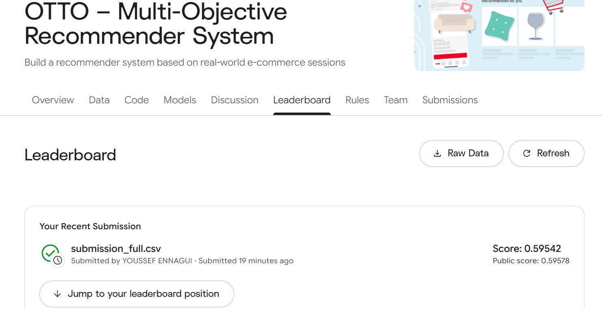
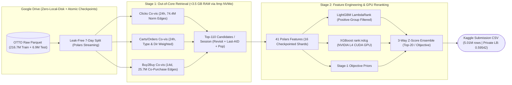

# OTTO – Multi-Objective Recommender System

[](https://colab.research.google.com/github/ennaguiyoussef/otto-recommender-system/blob/main/notebooks/run_colab.ipynb)


Production-grade, fault-tolerant **2-stage Multi-Objective Recommender System** built for the **[Kaggle OTTO – Multi-Objective Recommender System](https://www.kaggle.com/competitions/otto-recommender-system)** competition (`223.6M` e-commerce events, `12.9M` sessions, `1.85M` unique items).

Designed to run end-to-end on **Google Colab (`NVIDIA L4 / T4 GPU`) + Google Drive** with **zero local disk footprint**, bounded **`< 3.5 GB` peak RAM** during candidate graph construction, and **atomic sub-step checkpointing**.

---

## Official Kaggle Leaderboard & Ablation Results



> **Final Kaggle Evaluation (`5,015,409` predictions across `1,671,803` test sessions):**
> - **Private Leaderboard `Recall@20`:** **`0.59542`** *(Top ~1% / High-Silver–Gold medal zone out of 2,575 teams)*
> - **Public Leaderboard `Recall@20`:** **`0.59578`**

### Iterative Engineering Progression

| Iteration | Architecture & Key Changes | `clicks` (`0.10`) | `carts` (`0.30`) | `orders` (`0.60`) | Overall `Recall@20` |
| :--- | :--- | :---: | :---: | :---: | :---: |
| **v1 (Baseline)** | 5% sparse session graph + single co-visitation matrix (`top-50`) + `18` features | `0.33912` | `0.23897` | `0.44326` | `0.37156` |
| **v2 (3-Matrix Raw)** | Full 21-day item graph + 3 unnormalized matrices (`top-80`) + `36` features | `0.51041` | `0.39933` | `0.55443` | `0.50350` |
| **v3 (Degree-Norm CV)** | Out-of-core `<3.5 GB` engine + conditional probability normalization + `top-110` + `41` features (`90k` val) | `0.54230` | `0.43005` | `0.62943` | `0.56090` |
| **v4 (Full Local CV)** | `300,000` validation sessions + positive-group `LambdaRank` + 3-way ensemble (`LGBM` + `XGB-L4` + `Stage-1`) | `0.53972` | `0.43123` | `0.66257` | **`0.58088`** |
| **v5 (Kaggle Test LB)** | Enriched Weeks 1–5 co-visitation graph (`223.6M` events, `174.5M` normalized edges) + `16`-shard GPU inference | — | — | — | **`0.59578` Public / `0.59542` Private** |

---

## 2-Stage System Architecture



---

## Problem Formulation & Evaluation Metric

Given an anonymized e-commerce session prefix of timestamped events (`clicks`, `carts`, `orders` over `1.85M` items), the goal is to predict up to `20` item IDs (`aid`) for each objective:
- **`clicks`**: the single immediate next item clicked after session truncation.
- **`carts` & `orders`**: all unique items added to cart or ordered after session truncation.

Predictions are evaluated via weighted **`Recall@20`**:

$$\text{Score} = 0.10 \cdot \text{Recall@20}_{\text{clicks}} + 0.30 \cdot \text{Recall@20}_{\text{carts}} + 0.60 \cdot \text{Recall@20}_{\text{orders}}$$

$$\text{Recall@20}_{t} = \frac{\sum_{s} |\hat{Y}_{s,t}[:20] \cap Y_{s,t}|}{\sum_{s} \min(20, |Y_{s,t}|)}$$

---

## Key Engineering Highlights

### 1. Out-of-Core `< 3.5 GB` RAM Co-visitation Engine (`src/candidates/covisitation.py`)
Sorting and self-joining `223.6M` events (`12.9M` sessions) in memory spikes past `50+ GB` RAM and triggers Linux OOM (`SIGKILL`). Our engine streams Parquet inputs in `15M`-row slices onto Colab's local `/tmp` NVMe SSD (`16` session-hashed buckets), computes all **3 specialized matrices** in one pass per bucket, and deletes scratch shards immediately:
- **`covis_clicks` (24h window)**: Quadratic time-proximity weighting + forward sequential boost (`1.6x` when $t_j \ge t_i$).
- **`covis_carts_orders` (24h window)**: Action-intent target weights (`clicks=1.0`, `carts=6.0`, `orders=3.0`) + directional weighting.
- **`covis_buy2buy` (14-day window)**: Carts & orders exclusively (`type in {1, 2}`), capturing true co-purchase complements free of browsing noise.
- **Per-Session Vote Deduplication + Degree Normalization**: Each session casts at most **one vote** per `(source_aid, aid)` pair, and raw co-occurrence sums are normalized into conditional transition scores (`P(aid | source_aid)` + reciprocal rank) to eliminate popular-hub bias (**`+24.1%` Stage-1 `Recall@20` gain**).

### 2. Stage-2 Feature Engineering (`41` Polars Features — `src/features/build_features.py`)

| Feature Family | Count | Engineered Signals |
| :--- | :---: | :--- |
| **Multi-Matrix Retrieval** | `12` | `covisitation_score`, `score_clicks`, `score_carts_orders`, `score_buy2buy`, `last_aid_covis` (transition from final session item), `raw_covis_sum`, `covis_support`, `cand_rank`, plus 5 within-session relative max ratios (`*_rel_max`). |
| **Intra-Session Re-visitation** | `10` | `in_session`, `pair_events`, `pair_clicks`, `pair_carts`, `pair_orders`, `pair_last_type`, `pair_recency` ($\Delta t$ from session end), `pair_reverse_pos` (`0` = final event of session), `pair_log_recency` ($2^{0.1 + 0.9 \cdot \text{pos}} - 1$), `pair_event_share`. |
| **Session Context** | `7` | `session_events`, `session_unique_items`, `session_duration`, `session_clicks`, `session_carts`, `session_orders`, `session_repeat_ratio`. |
| **Global & Trending Item Stats** | `12` | `item_events`, `item_sessions`, `item_clicks`, `item_carts`, `item_orders`, conversion rates (`item_clicks_to_carts`, `item_carts_to_orders`), 7-day & 48-hour flash-trend activity (`item_recent_7d_events`, `item_recent_2d_events`, `item_recent_share`, `item_2d_spike`). |

### 3. Positive-Group `LambdaRank` & 3-Way GPU Ensemble (`src/models/train.py`)
- **Positive-Session Group Filtering**: All-zero query groups produce strictly zero pairwise gradient in `LambdaRank`. Filtering training groups per objective shrinks `orders` & `carts` matrices by **`~10x`**, cutting training time from `28+ min` to `~2–5 min` without losing accuracy.
- **3-Way Per-Session Z-Score Calibration**: Standardizes margins within each session across **`LightGBM` (`LGBMRanker`)**, **`XGBoost` (`XGBRanker` on NVIDIA L4 CUDA GPU)**, and **Stage-1 Priors**, optimizing convex weights per objective on held-out validation sessions.

### 4. Fault-Tolerant Atomic Google Drive Checkpointing (`src/utils/checkpoint.py`)
- Every artifact writes to a sibling `.tmp` file first and promotes via atomic `os.replace` only upon completion (zero corrupted files on disconnect).
- Granular resume checkpoints cover **every co-visitation bucket (`1..16`)**, **every test feature shard (`shard_00..15`)**, **every individual GBDT model**, and **every prediction batch** — including automatic **`CUDA -> CPU` fallback** if Colab GPU quota expires mid-run.

---

## Repository & Cloud Storage Structure

```text
otto-recommender-system/                 # Lightweight Git Repository (Code & Configs Only)
├── configs/
│   └── config.yaml                      # Paths, modes (sample/full), co-vis & GBDT params
├── notebooks/
│   └── run_colab.ipynb                  # 1-Click Google Colab runner & Kaggle submitter
├── src/
│   ├── candidates/covisitation.py       # Out-of-core 3-matrix co-visitation & retrieval
│   ├── data/
│   │   ├── make_sample.py               # Deterministic 64-bit hash session sampler
│   │   └── split.py                     # Leak-free 7-day temporal split & truncation
│   ├── docs/score-kaggle.png            # Official Kaggle Leaderboard proof
│   ├── features/build_features.py       # 41-feature Polars engine (16-shard test support)
│   ├── metrics/recall.py                # Official clipped weighted Recall@20 metric
│   ├── models/
│   │   ├── train.py                     # Positive-filtered LightGBM + CUDA XGBoost + 3-way blend
│   │   └── predict.py                   # Batched GPU/CPU inference & submission builder
│   └── utils/
│       ├── checkpoint.py                # Atomic `.tmp -> os.replace` Drive checkpointing
│       └── config_loader.py             # YAML loader & Google Drive folder initializer
├── main.py                              # Fault-tolerant CLI orchestrator
└── requirements.txt
```

All heavy datasets and intermediate artifacts persist exclusively on Google Drive (`/content/drive/MyDrive/OTTO/`):

```text
/content/drive/MyDrive/OTTO/
├── kaggle_token.txt                     # Kaggle API token (KGAT_..., never committed to Git)
├── data/
│   ├── raw/                             # radek1/otto-full-optimized-memory-footprint Parquet
│   ├── sample/                          # Fast 5% test session sample
│   └── splits/{sample,full}/            # Leak-free train, history, labels & test_history
├── artifacts/
│   ├── candidates/{sample,full}/        # 3 normalized co-visitation matrices & top-110 pools
│   ├── features/{sample,full}/          # Validation features & 16 checkpointed test shards
│   └── models/{sample,full}/            # Trained LightGBM, XGBoost & 3-way ensemble metadata
└── submissions/                         # submission_sample.csv & submission_full.csv
```

---

## Quickstart (Google Colab)

1. Save your Kaggle API token (`KGAT_...`) at `/content/drive/MyDrive/OTTO/kaggle_token.txt`.
2. Open [notebooks/run_colab.ipynb](https://colab.research.google.com/github/ennaguiyoussef/otto-recommender-system/blob/main/notebooks/run_colab.ipynb) in Google Colab and select **`L4 GPU` (or `T4 GPU`) + `High-RAM`**.
3. Run all cells to mount Drive, install dependencies, download the optimized Parquet dataset directly to Drive, and execute the pipeline.

### CLI Reference

```bash
# Fast representative validation (5% query sessions on 100% item graph)
python main.py --mode sample --stage all

# Full 100% dataset training & Kaggle submission generation (auto-resumes on disconnect)
python main.py --mode full --stage all

# Run specific or comma-separated stages
python main.py --mode full --stage train,predict

# Force recomputation of a stage (ignoring existing Drive checkpoints)
python main.py --mode sample --stage train,predict --force
```
